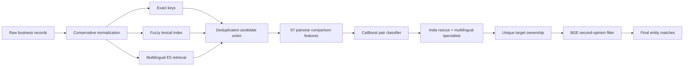

# Business Entity Resolution at Scale

**Amazon ML Challenge 2026 · Team Tara · portfolio edition**

I built an entity-resolution pipeline to identify the same business across three noisy data sources. It combined exact and fuzzy blocking, multilingual embedding retrieval, a CatBoost pair classifier, and targeted neural reranking for difficult India matches. The final submission received a **reported public leaderboard F0.5 of 0.949**. My approximate standing was **2,000 out of 11,000 teams**; the rank is my own snapshot, not an official final private-leaderboard claim.

This is a **code and methodology showcase**. It intentionally excludes the organizer's dataset, ground-truth labels, test predictions, generated candidate pairs, trained weights, and cloud credentials.

## What I worked on

I drove the data normalization and shared retrieval foundation, engineered comparison features, trained and evaluated the CatBoost baseline, investigated India-specific recall failures, and integrated the later reranking and target-ownership stages into the final output. The work was submitted as **Team Tara** with Tijil Sharma, Anushka Verma, and Sarthak Khubchandani.

The main challenge was finding the right target among millions of possible Source-2 and Source-3 records for each Source-1 business. A classifier cannot recover a true match that blocking never retrieves, so I measured candidate recall separately from match quality and spent most of the effort on that boundary.



The initial union capped candidates at 100 per Source-1 record. Later rescue routes searched beyond that set for Indian records with few existing matches. The final conflict step allowed one Source-1 record to match multiple targets while preventing the same target from being assigned to multiple Source-1 businesses.

## Results, with the right denominators

| Measure | Result | What it means |
|---|---:|---|
| Public leaderboard macro F0.5 | **0.949** | Team-reported score for the final submission; private score unknown |
| Approximate rank | **~2,000 / ~11,000 teams** | My observed standing, not a verified final ranking |
| Capped training-union true-link recall | **88.90%** | Share of labeled true links present among candidates, before classification |
| Capped training-union India recall | **78.29%** | The gap that motivated targeted India rescue |
| Capped training-union oracle macro F0.5 | **0.9496** | Upper bound for that *earlier candidate pool*, not a model score |

The final test candidate file covered roughly **206 million** Source-1/target pairs. It is excluded here because it contains organizer data. See [results and limitations](docs/results.md) for the distinction between retrieval diagnostics and leaderboard scoring.

## Engineering decisions

- **Conservative normalization:** Preserve the raw business name and address while adding comparison views. Avoid deleting distinctions such as Indic marks and leading zeros in numeric tokens.
- **Complementary retrieval:** Exact keys are precise, fuzzy lexical search handles spelling and address variation, and multilingual E5 helps across scripts. A capped union controls downstream cost.
- **Explicit pair features:** Name, address, numeric, missingness, script, and retrieval-route evidence feed CatBoost. Missing fields are not treated as agreement.
- **Targeted neural work:** MiniLM specialists rerank hard India candidates and the old top-10 pool; BGE provides a final second opinion on selected rescue links.
- **Precision-first decisions:** F0.5 penalizes false merges heavily. Thresholds were selected on grouped development splits, with separate holdout checks.

The detailed design is in [methodology](docs/methodology.md), and [reproduction notes](docs/reproduction.md) explain what can be run without redistributing challenge data.

## Repository map

| Path | Contents |
|---|---|
| `src/ber/data/` | Auditing, normalization, and train/validation splitting |
| `src/ber/retrieval/` | Exact, fuzzy, E5, union, and rescue retrieval |
| `src/ber/features/` | Pairwise comparison features |
| `src/ber/models/` | CatBoost and multilingual reranking code |
| `src/ber/evaluation/` | Candidate coverage and entity-level scoring |
| `tests/` | Synthetic-data unit tests |
| `configs/` | Baseline configuration |

Run the synthetic tests with Python 3.11 after installing the pinned dependencies:

```bash
python3.11 -m venv .venv
.venv/bin/python -m pip install --upgrade pip
.venv/bin/python -m pip install --require-hashes \
  --extra-index-url https://download.pytorch.org/whl/cu124 \
  -r requirements-training.lock
.venv/bin/python -m pip install --no-deps -e .
PYTHONPATH=src .venv/bin/python -m unittest discover -s tests -v
```

The original experiment ran on Linux with Python 3.11 and an NVIDIA RTX 4060 laptop. A full-corpus reproduction requires the challenge's private training/test files and substantial compute. The pretrained encoders are [E5-small (MIT)](https://huggingface.co/intfloat/multilingual-e5-small), [multilingual MiniLM (Apache-2.0)](https://huggingface.co/cross-encoder/mmarco-mMiniLMv2-L12-H384-v1), and [BGE reranker v2 M3 (Apache-2.0)](https://huggingface.co/BAAI/bge-reranker-v2-m3).

No contest data or prediction TSVs are included. This repository has no open-source license; it is shared to demonstrate the engineering approach.
